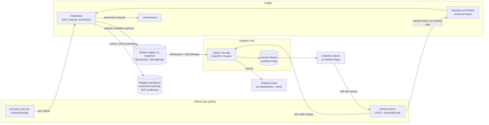

# Name That LLM: End-to-End MLOps Project Design

*Status: draft for review · 2026-10-23 · Written by Claude with Ryqn0*

## 1. Intent

Build a real, production-style ML system around a live Kaggle competition to learn every
stage of the ML/DL/LLMOps lifecycle by doing it. The project should end with three things:
a strong leaderboard result, a public portfolio repo, and a live demo app.

The competition is [Name That LLM](https://www.kaggle.com/competitions/name-that-llm):
given a passage, predict which of 18 LLMs wrote it.

**Why this project:** the user wants hands-on experience with every stage: EDA, data
ingestion, cleaning, feature engineering, training, backtesting, A/B testing, inference,
CI/CD and a deployed app. Every step should be explained and the code commented heavily.
A live competition gives an honest scoreboard and a hard deadline.

## 2. Goals, non-goals, anti-goals

**Goals**
- **G1, leaderboard:** aim for a medal, meaning the top 10% (about rank 260 or better out of
  ~2,600 teams).
- **G2, full lifecycle:** every stage is implemented for real, with industry-standard tools,
  one tool per job.
- **G3, demo app:** anyone pastes a passage and sees which of the 18 models probably wrote it.
  A/B testing and monitoring run on the app.
- **G4, public repo:** a public GitHub repo with a progress diary that reads like a story.
  Every step is explained and the code is heavily commented.
- **G5, the user's ideas:** each idea gets a candid review and, if promising, a proper
  experiment.

**Non-goals**
- Deploying on a big cloud (AWS, GCP or Azure). It's an optional extra after the deadline
  (§13).
- Kubernetes, Airflow or Kubeflow, feature stores, and training across multiple machines.
- Paid services. Generating training data through paid LLM APIs is excluded unless the host
  explicitly allows it **and** the user approves a budget.

**Anti-goals** (the project fails if any of these happen, even if everything else works)
- Breaking the rules: committing competition data, sharing code privately, or making code
  public without the required Kaggle post.
- Choosing the final submissions by public-leaderboard score alone. The public leaderboard
  covers only 40% of the test data, so this overfits it.
- Tool sprawl: every tool must have a one-sentence answer to "what does it do for us".
- Infrastructure work crowding out leaderboard progress before the deadline.
- An app that presents itself as a general "AI detector". It only tells these 18 models apart.

## 3. Facts (verified 2026-10-23)

### 3.1 Competition

| Item | Detail |
|---|---|
| Task | Identify which of 18 models wrote each passage |
| Classes | **OpenAI:** gpt-5.5, gpt-5.6-luna, gpt-5.6-sol, gpt-5.6-terra, gpt-6-astra. **Anthropic:** claude-fable-5, claude-opus-4-6, claude-opus-4-8, claude-opus-5, claude-sonnet-5. **Google:** gemini-3.1-pro-preview, gemini-3.6-flash, gemini-3.7-flash, gemini-3.8-flash. **ZAI:** glm-5.3, glm-5.3-flash. **Qwen:** qwen3.8-max. **Moonshot AI:** kimi-k3 |
| Metric | Balanced accuracy: the average of each model's recall. Random guessing scores about 0.056 |
| Submission | A Kaggle notebook with internet off that finishes within 9 hours on CPU or GPU (P100 or 2×T4) and writes `submission.parquet` with columns `id` and `model` |
| Limits | 5 submissions per day and 2 final picks. The public leaderboard uses about 40% of the test data, the private one about 60% |
| Dates | Entry and team-merge deadline 2027-01-06; final submission deadline 2027-01-13 23:59 UTC |
| Compute | Kaggle GPU quota is about 30 hours per week |

### 3.2 Data (checked locally)

- `train.csv` has 2,699 rows with columns `id, prompt_id, text, model`, covering 150 prompts.
- 149 of the 150 prompts were answered by all 18 models, each exactly once. The remaining
  prompt has 17 answers.
- The classes are balanced: 150 passages per model, except claude-fable-5 with 149.
- Passages are 36–274 words long (mean 115). Each model's mean length falls between 101 and
  124 words, so length alone is a weak signal.
- The host flattened the formatting: no passage contains newlines, bold or bullets. 39% of
  passages contain an em dash (—).
- There are no duplicate texts.
- `test.csv` has only 3 example rows. The ~4,000 hidden rows, from prompts not in train,
  exist only while Kaggle scores a submission.

### 3.3 Rules that shape the design

- **Data license:** CC BY-SA 4.0, usable "for any purpose, whether commercial or
  non-commercial". A public app with a model trained on this data is allowed.
- **Data security clause:** we may not redistribute Competition Data to non-participants.
  Raw data therefore never goes into the repo, the app, or committed notebook outputs.
- **Public code sharing:** allowed, but the code must also be shared on Kaggle (forum or
  notebook), and it counts as licensed under an approved open-source license. So the repo
  uses the **MIT** license, and a **Kaggle forum post linking the repo** goes up when the
  first competition code is pushed.
- **Private code sharing:** sharing code with anyone outside your team is banned.
- **External data and pre-trained models:** allowed if free and publicly available, or of
  "minimal cost" under the rules' Reasonableness Standard. Whether passages generated by the
  18 candidate models through their APIs count is still being clarified on the forum.
- **Winners must deliver reproducible code** (training, inference and environment) under an
  approved open-source license. The repo structure below meets this by default.

### 3.4 Landscape from the forum (community claims as of 2026-10-23, not verified)

- A public CPU baseline validated with prompt-grouped cross-validation scores 0.353 on the
  leaderboard.
- Hidden states from early layers of an open Qwen model score about 0.39 in cross-validation,
  versus about 0.31 from late layers.
- Test-time prompt grouping is already being discussed publicly. Our advantage will come from
  doing it well, not from it being secret.
- The top thread (115 votes) asks whether extra generated training data will decide the
  winner. The host hasn't clarified yet.
- Another thread reports that requests to gemini-3.7-flash may have been routed to
  gemini-3.8-flash. That would mean some label noise between those two classes.

## 4. Constraints and working agreements

- **Notebooks first.** EDA, experiments, training and submissions run in Kaggle notebooks.
  The local PC is for editing code, git and quick tests.
- **uv** manages all Python environments and dependencies.
- **Everything public as we go**: the repo (`github.com/Ryqn0/name-that-llm`, MIT license)
  and our Kaggle notebooks. **One timing exception:** the final ensemble submission notebook
  (phases P7–P8) stays private until the deadline passes, then gets published. When a
  top-scoring notebook goes public, hundreds of teams submit copies, which would push us out
  of the medal zone without adding anything to the learning. *(Claude's call; the user
  delegated this decision.)*
- **The Kaggle forum post** linking the repo goes up when the first competition code is
  pushed, as the rules require.
- **Free tiers only.** Accounts: Kaggle and GitHub (Ryqn0) exist. Weights & Biases, DagsHub
  (for MLflow), Hugging Face and Grafana Cloud accounts still need to be created, each in the
  phase that first needs it.
- **Explain everything.** Notebooks and code carry heavy comments that explain the *why*, not
  just the *what*. Every working session ends with a diary entry.
- **Who writes what.** Claude builds the scaffolding and most of the code. At genuine
  decision points, the user writes small key pieces (5–10 lines) with guidance, because
  writing them is how the learning sticks.
- **Local machine quirk.** Avast's HTTPS scanning breaks Python and uv network access, and it
  crashes Python by injecting `SSLKEYLOGFILE`. A local setup script applies the verified
  workaround (§9.4).
- **Disk.** Project files live on D:. Tool caches stay in their default C: locations, which
  have plenty of space.

## 5. Architecture



**Two products share the same code:**

1. **Batch inference (the Kaggle submission).** An offline notebook processes ~4,000
   passages at once with up to 9 hours of GPU. It can afford a heavy ensemble plus the
   prompt-grouping post-processing.
2. **Real-time inference (the app).** It handles one passage at a time on a free CPU and
   should answer in under about 1 second, so it needs a light model. Prompt grouping can't
   apply because a single passage has no group.

Each product has its own champion model.

## 6. Lifecycle stages

### 6.1 Data ingestion

- In Kaggle notebooks, the data is mounted at `/kaggle/input/name-that-llm/`.
- Locally and in CI, `kaggle competitions download` fetches it into `data/raw/`, which is
  gitignored.
- A single `load_raw()` function returns validated DataFrames wherever it runs.
- Validated, typed copies are saved as parquet and logged to W&B as versioned artifacts. This
  gives lineage: every model records which data version it was trained on. The W&B project
  stays private because it holds competition data. Selected W&B Reports that contain charts
  only can be made public.

### 6.2 Data validation (data contracts)

Pandera schemas check the train, test and submission data:

- **Train:** `id` is unique; `model` is one of the 18 labels; `text` is non-empty; there is
  at most one row per (`prompt_id`, `model`) pair.
- **Submission:** every test `id` appears exactly once, there are no nulls, and every label is
  one of the 18. **The submission notebook validates the file before writing it.** A failed
  check costs nothing, while a bad file wastes one of the 5 daily submissions.

### 6.3 Data cleaning

**Principle: for authorship, the "noise" is the signal.**

- Apply only safe normalization: Unicode NFC and trimming leading and trailing whitespace.
- **Keep** em dashes, curly versus straight quotes, punctuation spacing and casing. These are
  the fingerprints.
- Adopt a cleaning step only if cross-validation shows it doesn't hurt the score.
- If we ever use external data, apply the host's flattening to it first: a single paragraph
  with no markdown. The community saw external data hurt scores without this step.

### 6.4 EDA (Kaggle notebook `01-eda`)

- Class balance and prompt structure.
- Passage lengths.
- Punctuation and character usage per model and per lab.
- The most discriminative n-grams.
- Which models are most similar to each other.
- A check of the gemini-3.7/3.8 label-noise hypothesis.
- Style-only clustering, to see the natural model families.

The notebook shows only aggregate statistics and charts, never raw passages.

### 6.5 Feature engineering

- **Sparse features:** word 1–2-gram and character 1–5-gram TF-IDF weights or counts.
- **Style features:** rates of punctuation marks (`— ; : , ( ) " '` plus curly quotes),
  sentence-length statistics, frequencies of common function words (the, of, however),
  vocabulary richness, and typical opening and closing phrases.
- **Dense features:** sentence embeddings, which capture topic and are used for prompt
  grouping, and hidden states from open LLMs (early layers, following the community finding).
- **LLM log-probability and perplexity features** from open models (in later phases).

### 6.6 Backtesting (validation)

- **Folds.** 5-fold GroupKFold on `prompt_id` with a fixed seed. The folds are generated
  deterministically by code and stored as a W&B artifact, so every experiment uses identical
  splits.
- **Out-of-fold predictions.** Every experiment produces out-of-fold (OOF) probabilities for
  all 2,699 rows and stores them as a W&B artifact. These give an honest score, feed the
  ensembles, and allow paired comparisons between models.
- **Metrics.** Balanced accuracy is the primary metric. We also track per-class recall, the
  confusion matrix, accuracy at the lab level, and log loss (to check calibration).
- **Puzzle backtest.** Hide `prompt_id`, cluster the passages by topic, then run the
  assignment step. This scores the full post-processed pipeline exactly as it will run on the
  hidden test.
- **CV-to-leaderboard tracker.** Each submission records its CV score and its public
  leaderboard score. How closely the two agree tells us whether CV can be trusted.
- **Final decisions** use repeated grouped CV (3 seeds × 5 folds) plus a **prompt-level
  bootstrap**: resample whole prompts, not rows, because the 18 answers to one prompt are
  correlated.

### 6.7 Model roadmap

| Stage | What | Why |
|---|---|---|
| M1 | TF-IDF features with Multinomial or Complement Naive Bayes, NB-SVM, logistic regression and LinearSVC | Fast, strong text baselines, and our first offline A/B test |
| M2 | Prompt grouping (topic embeddings plus clustering), then assignment with `scipy.optimize.linear_sum_assignment` on the classifier's log-probabilities | Uses the "each model answers each prompt once" structure |
| M3 | Style features, plus a two-step model that first predicts the lab, then the model | A different signal that should reduce confusion between models from the same lab |
| M4 | Fine-tuned encoder models (DeBERTa-v3, ModernBERT) on Kaggle GPUs, with Optuna for the key hyperparameters | Captures style in context |
| M5 | An open LLM fine-tuned as a classifier (Qwen or Gemma family, LoRA, 4-bit quantization), plus early-layer features | The strongest single models in recent text competitions |
| M6 | An ensemble (weighted average or stacking of OOF predictions) with temperature calibration, followed by M2 post-processing | Combines models that make different mistakes |
| M7 | The app model: distil the ensemble into a small CPU model, or use the best light model | Trades accuracy against speed and cost |

Each stage is an experiment with a stated hypothesis. It's logged in W&B and IDEAS.md, and
adopted only if the backtest supports it.

**Publishing:** everything is public as we go, except the final ensemble submission notebook
(M6 with everything combined), which is published right after the deadline (§4).

### 6.8 Inference

- **Batch (the submission):** `notebooks/90-submit` runs with internet off and attaches the
  library wheel dataset and the model artifacts. It predicts, validates the result, and
  writes `submission.parquet`. Before every submission, we time a full run on 4,000 synthetic
  rows to make sure it fits within 9 hours.
- **Real-time (the app):** see §7.

### 6.9 A/B testing and continuous improvement

There are three levels, cheapest first.

1. **Offline, for every candidate model.**
   - The challenger and the champion are compared on identical folds.
   - **Promotion gate:** the mean improvement in balanced accuracy is positive, and its 95%
     prompt-bootstrap confidence interval excludes 0. A McNemar test is reported alongside.
   - A CI job compares the two models' OOF artifacts from W&B and posts the report.
2. **Leaderboard.**
   - Each submission changes one thing at a time.
   - The CV-to-leaderboard relationship is tracked.
   - The two finals are the best robust-CV model plus one meaningfully different model.
     Public-leaderboard score alone never decides.
3. **Online, in the app.**
   - Traffic is split between champion and challenger, 50/50 by default and configurable.
     Each visitor is assigned by a hash of an anonymous session id, so they always get the
     same model.
   - Each request logs the arm, prediction, latency, and optional user feedback ("I know which
     model wrote this").
   - An analysis notebook computes per-arm accuracy with confidence intervals. It also
     explains the "peeking" problem: checking results repeatedly and stopping early produces
     false winners.
   - Real traffic will be low, so a **replay simulator** sends labelled out-of-fold passages
     through the live API to exercise the whole loop. Its results are clearly labelled as
     simulation.

**Promotion and retraining:**
- **W&B and MLflow have separate jobs.** W&B records every experiment: metrics, curves, OOF
  predictions, sweeps. MLflow holds only *release candidates*: models good enough to deploy,
  packaged in MLflow's standard `pyfunc` format and registered in the MLflow Model Registry
  (hosted free on DagsHub). Each registered version is tagged with the URL of the W&B run that
  produced it, so lineage is never lost.
- Promoting a model means moving the `@champion` alias in the MLflow registry. The app loads
  `models:/name-that-llm@champion` and picks up the change on its next restart or redeploy.
- **Where model files live:** the Kaggle copy (notebook output or Kaggle Model) feeds the
  offline submission notebook. The MLflow registry is the source of truth for the app and for
  A/B decisions. Large leaderboard-only models (for example LLM weights) stay on Kaggle.
- **Continuous training loop** (a GitHub Actions workflow, run manually or weekly):
  1. Push a training-job notebook to Kaggle through the API.
  2. Wait for it to finish, then download its artifacts.
  3. Run the offline promotion gate.
  4. Register the winner in MLflow with the `@challenger` alias.
  5. Deploy it as the app's B arm.

### 6.10 Monitoring

Monitoring has two layers, because they answer different questions on different time scales.

**Layer 1: "Is the service healthy right now?" Prometheus and Grafana, updated every few seconds**
- **Metrics endpoint:** the app exposes Prometheus metrics at `/metrics` through
  `prometheus_client`. They include:
  - the RED metrics: request **R**ate, **E**rror rate, and latency (**D**uration) as a
    histogram
  - live ML counters: requests per A/B arm, counts of each predicted model, a histogram of
    prediction confidence, and the versions of the loaded models
- **Locally:** `docker compose up` runs the app, Prometheus and Grafana together. The
  dashboard is loaded from a JSON file in the repo ("dashboards as code").
- **Live:** Grafana Cloud's free tier (10,000 metric series, 14 days of history) collects the
  live app's metrics. It runs the same dashboard plus alert rules: app down, high error rate,
  slow 95th-percentile latency.
- **How the live metrics get there:** if the free tier allows it, Grafana Cloud scrapes the
  Space's `/metrics` itself, protected by a token. Otherwise the app pushes its metrics with
  OpenTelemetry (OTLP). The builder checks which during P6.
- Free Spaces go to sleep when nobody uses them, so gaps in the charts are expected.

**Layer 2: "Is the model still right?" Evidently, daily**
- **Data drift:** Evidently compares descriptors of incoming text against the training data.
  The descriptors are length, punctuation rates, the share of non-letter characters, and
  language.
- **Prediction drift:** the distribution of predicted labels compared with uniform, which is
  the training distribution.
- **Quality:** accuracy on user feedback, when there is any.
- **Daily job:** a scheduled GitHub Action pulls the logs from the private Hugging Face
  dataset and builds an Evidently HTML report published on GitHub Pages. If a drift test
  fails, it opens a GitHub issue.
- **Privacy:** the app stores no raw text. It keeps only the descriptors, the prediction, the
  model version, the A/B arm, the latency and any feedback.
- **Public reports show aggregate numbers only.** Evidently can embed example rows, so the
  published reports must contain no raw passages, neither user input nor competition data.

### 6.11 CI/CD (GitHub Actions)

| Workflow | Trigger | What it does |
|---|---|---|
| `ci.yml` | Every push and pull request | `uv sync`, then ruff, then pytest (schemas, features, no prompt leaking between folds, metric, submission validator, API), then a Docker build |
| `deploy-app.yml` | Push to `main` that changes the app or `src` | Pushes to the HF Space, then smoke-tests `/health` on the live URL |
| `release-lib.yml` | A git tag matching `v*` | Builds the wheel and publishes a new version of the Kaggle Dataset that offline notebooks use |
| `train.yml` | Manual or weekly | Runs the Kaggle training job, collects artifacts, runs the offline A/B gate, registers the challenger |
| `monitor.yml` | Daily | Builds the Evidently report for GitHub Pages and opens an issue on drift |

- **Secrets:** `KAGGLE_API_TOKEN`, `WANDB_API_KEY`, `HF_TOKEN`, the DagsHub token for
  MLflow and the Grafana Cloud token live in GitHub Secrets, HF Space secrets and Kaggle Secrets, never in code.
- **Secret scanning:** GitHub's built-in secret scanning and push protection are enabled. Both
  are free for public repos.
- **Branch flow:** feature branch, then pull request, then green CI, then merge. Each
  experiment gets its own pull request, so its comparison report lives on that PR.

## 7. The app

- **Service:** a FastAPI app in one Docker container on Hugging Face Spaces (free CPU tier).
- **Endpoints:**
  - `POST /predict`: takes a text and returns the top models with probabilities, plus the
    lab, model version and A/B arm.
  - `POST /feedback`: records the user's answer about the true model.
  - `GET /health` and `GET /version`.
  - `GET /metrics`: Prometheus-format metrics for Grafana (§6.10), protected by a token.
- **UI:** one HTML page served by FastAPI. A text box, probability bars, and optional
  feedback.
- **Model loading:** at startup, the app loads `models:/name-that-llm@champion` (and
  `@challenger`, if set) from the MLflow registry with `mlflow.pyfunc`, using a Space secret.
  The `pyfunc` format gives every model the same `predict()` interface, so the app never needs
  to know whether it's serving Naive Bayes or a transformer.
- **Input safety:** Pydantic validation (20 to 1,000 words), a request size cap, a simple
  per-IP rate limit, and no raw-text storage.
- **Model card** on the Space page: what the app does (only these 18 models), the training
  data, scores, and limitations. It states clearly that this is not an AI detector.

## 8. The pro stack: one tool per job

| Job | Tool | Why this one |
|---|---|---|
| Environments and dependencies | **uv** (pyproject.toml plus a lockfile) | Fast and reproducible; the user's choice |
| Code quality | **ruff**, **pre-commit**, **pytest**, **nbstripout** | The modern Python standard. nbstripout removes notebook outputs, which keeps diffs readable and data out of git |
| Configs | **YAML plus Pydantic** | Typed, validated experiment settings |
| Data contracts | **Pandera** | DataFrame schema checks as code; lighter than Great Expectations |
| Experiment tracking | **Weights & Biases** | The best dashboards for training runs, and it works from Kaggle without running a server. It covers classic ML, deep learning, and LLM applications (through its Weave product) |
| Model packaging and registry | **MLflow** (`pyfunc` format plus Model Registry, hosted free on DagsHub) | The open-source industry standard. Gives every model one `predict()` interface, and its `@champion` / `@challenger` aliases drive A/B tests and promotions |
| Hyperparameter tuning | **Optuna** | The standard tuning library, with W&B integration |
| Classical ML | **scikit-learn** | Naive Bayes, linear models, calibration, CV |
| Deep learning and LLMs | **PyTorch, Transformers, PEFT, bitsandbytes** | Fine-tuning encoders, and LoRA on open LLMs, within Kaggle's GPUs |
| Compute and artifact storage | **Kaggle Notebooks, Datasets and Models** | Free GPUs and versioned inputs for offline scoring |
| Serving | **FastAPI, Uvicorn, Docker** | The standard way to serve an API, in one container that runs anywhere |
| Hosting | **Hugging Face Spaces** | Free, built for ML, supports Docker and secrets |
| Service monitoring | **Prometheus and Grafana**: locally through Docker Compose, live on Grafana Cloud's free tier | The industry standard for metrics, dashboards and alerts. Tracks request rate, errors and latency, plus live A/B and prediction counters |
| ML monitoring | **Evidently** | Open-source drift and quality checks on text data and predictions, which Prometheus isn't built for |
| Prediction logs | **huggingface_hub CommitScheduler** writing to a private HF dataset | Durable logs from a Space that otherwise loses its disk on restart |
| CI/CD and job scheduling | **GitHub Actions** | Tests, deployments and scheduled jobs in one place |
| Documentation | Markdown, Mermaid diagrams, ADRs (architecture decision records), a model card | Renders directly on GitHub and follows common professional conventions |

**Considered and skipped**

| Tool | Why skipped |
|---|---|
| W&B Registry | It would duplicate MLflow's registry, leaving two sources of truth for which model is live |
| MLflow for experiment tracking | W&B's training dashboards are stronger. MLflow logs only the release runs it needs for the registry |
| DVC | The competition data never changes and Kaggle already versions it. W&B artifacts handle derived data |
| Airflow, Kubeflow, Kubernetes | Built for clusters and teams. Our jobs are a few steps on free compute |
| Prefect, ZenML | Good orchestrators, but GitHub Actions already schedules our loop. Prefect is an optional extra |
| Feature store (Feast) | We have no shared online features to serve |
| Great Expectations | Heavier than Pandera for the same checks |
| BentoML | FastAPI is more universal and teaches the underlying pieces directly |
| AWS, GCP, Azure | Not needed, and they add billing risk. Cloud Run is an optional extra |

## 9. Repository and workflow

### 9.1 Layout

```
name-that-llm/
├── CLAUDE.md            # one line, "@Context.md", so every Claude session loads the brief
├── Context.md           # living brief: facts, decisions, status, conventions, next steps
├── README.md            # public face: what this is, results, how to run, links
├── DIARY.md             # progress diary, newest entry first
├── IDEAS.md             # ideas backlog: idea, verdict, experiment, result
├── LICENSE              # MIT
├── pyproject.toml, uv.lock
├── configs/             # YAML experiment configs
├── src/name_that_llm/   # shared package: data, validation, cv, features, models, metrics, serving
├── notebooks/           # copies of the public Kaggle notebooks, with outputs stripped
├── jobs/                # Kaggle training jobs that CI runs
├── app/                 # Dockerfile, Space README with the model card, static UI
├── tests/
├── scripts/             # local setup (the Avast workaround), helper commands
├── docs/                # this design, adr/, plans
└── .github/workflows/
```

`data/`, `models/`, `wandb/` and `.env` are gitignored.

### 9.2 How notebooks and the repo connect

- **Exploration notebooks** are written on Kaggle, which is their source of truth. They're
  copied into `notebooks/` with `kaggle kernels pull`, or Kaggle's GitHub integration if it's
  available, with outputs stripped. The version with outputs lives on Kaggle.
- **Training-job notebooks** have their source of truth in `jobs/`. CI pushes and runs them
  through the Kaggle API.
- **The shared package reaches Kaggle in two ways:**
  - Notebooks with internet on use `pip install git+https://github.com/Ryqn0/name-that-llm@<tag>`.
  - The offline submission notebook installs a wheel stored in a Kaggle Dataset.
- **The final ensemble notebook** is copied into the repo right after the deadline.

### 9.3 Documentation rhythm

- **Every session:** a DIARY.md entry (what we did, what we learned, scores, next steps) and
  an update to the status in Context.md.
- **Every significant decision:** a short ADR in `docs/adr/` covering the context, the
  decision and its consequences.
- **IDEAS.md:** every idea, from the user or Claude, with its verdict: feasibility, expected
  gain, cost, risks, and the cheapest test.

### 9.4 Local setup on Windows with Avast

`scripts/setup-local.ps1` makes local Python, uv and Kaggle CLI commands work in the user's
own terminal without manual steps. The verified fixes:

- Build a combined certificate bundle (certifi's bundle plus Avast's `wscert.pem`) and point
  `REQUESTS_CA_BUNDLE` and `SSL_CERT_FILE` at it.
- Make uv use the system certificates (`--system-certs` or the equivalent setting).
- Clear `SSLKEYLOGFILE` before Python runs.

How these get applied persistently is the builder's call.

## 10. Phases and milestones

The phases overlap, and their order puts leaderboard-critical work first.

| Phase | Target dates | Lifecycle stages | Done when |
|---|---|---|---|
| P0 Foundations | Oct 23–25 | Repo, uv, docs, CI skeleton, local setup, accounts | CI passes on the empty package; Context.md, DIARY.md and IDEAS.md exist |
| P1 Data | Oct 26 – Nov 1 | Ingestion, validation, cleaning, EDA | EDA notebook is on Kaggle; schemas and tests pass; the Kaggle forum post is published |
| P2 Backtest and baselines | Nov 2–8 | Backtesting, sparse features, training, batch inference, first offline A/B test | First valid leaderboard submission; its CV and leaderboard scores are logged; W&B tracking works |
| P3 Puzzle trick and style | Nov 9–22 | Puzzle trick, style features, lab-then-model hierarchy | Puzzle backtest scored; leaderboard A/B with and without grouping |
| P4 App v1 and CD | Nov 16–29 | Real-time inference, Docker, CD, model card | The live Space serves the public baseline and redeploys on every merge |
| P5 Transformers | Nov 23 – Dec 13 | Deep-learning training on GPU, Optuna | An encoder model beats the baseline in CV |
| P6 MLOps loop | Dec 7–20 | Monitoring (Prometheus and Grafana, Evidently), online A/B, replay simulator, continuous-training workflow | The Grafana dashboard is live with alerts; the drift report is on GitHub Pages; the A/B analysis notebook runs; `train.yml` works end to end |
| P7 LLM and ensemble | Dec 14 – Jan 3 | LLMOps (LoRA, quantization), ensembling, calibration | Best CV score so far; the submission's runtime is well under 9 hours |
| P8 Finals | Jan 4–13 | Final selection and freeze | Two finals chosen by the rule in §6.9 |
| P9 Publish | Jan 14 onward | Docs and write-up | Final ensemble notebook published; Kaggle write-up posted; the app runs the best production model; README shows the results |

## 11. Risks and mitigations

| Risk | Mitigation |
|---|---|
| The hidden test doesn't keep the one-answer-per-model-per-prompt structure | Leaderboard A/B with and without grouping; fall back to a soft version of the assignment |
| With only 150 prompts, CV scores are noisy | Repeated CV and a prompt-level bootstrap; few, meaningful comparisons |
| A ruling on generated data changes the competition | Watch the forum; keep an IDEAS.md entry ready; decide the budget with the user |
| The 30-hour weekly GPU quota runs out | Run classical models on CPU; plan GPU runs ahead; save training checkpoints |
| gemini-3.7-flash and gemini-3.8-flash labels are noisy | Check in EDA; adjust training if confirmed |
| W&B and MLflow blur together | A strict split: W&B for experiments, MLflow for releases. Each MLflow model version is tagged with its W&B run URL |
| Competition data gets redistributed | Gitignore `data/`; strip notebook outputs with nbstripout; show no training passages in the app |
| The user's available time is unknown | Phases are ordered by value, leaderboard-critical first |
| Avast breaks local tools | Setup script; most work runs in the cloud anyway |

## 12. Calls made by Claude (to check)

- Everything public as we go, except the final ensemble notebook, which is published right
  after the deadline (the user delegated this decision).
- Weights & Biases for experiments plus MLflow (hosted on DagsHub) for packaging and the
  registry; Hugging Face Spaces for hosting; GitHub Actions as the only scheduler; no DVC; no
  big cloud provider.
- Prometheus and Grafana (Grafana Cloud free tier) for service monitoring, Evidently for ML
  monitoring, and Pandera for data validation.
- MIT license and the repo name `name-that-llm`.
- A single DIARY.md file, newest entry first.
- Committed notebooks have their outputs stripped; the rendered versions live on Kaggle.
- The app stores no raw text.
- The target is a medal.
- Work goes through pull requests, even when working solo, to practice the professional flow.
- Assumed solo, with no teammates.
- All docs and comments in English, for the public portfolio.
- Datasets generated by others and posted publicly on Kaggle may be tested offline at any
  time. They're used in submissions only after the host's ruling on generated data.

## 13. Left to the builder

These details are decided during planning or implementation:
- Exact model checkpoints and hyperparameters, and the detailed list of style features.
- The Evidently metric set and the look of the UI.
- The shape of the command-line interface.
- How the Avast workaround gets applied persistently.
- How the library wheel is packaged for offline use.

## 14. Optional extras after 2027-01-14

- Deploy the same container to Google Cloud Run (free tier) to practice on a big cloud.
- Prefect for orchestration.
- A Locust load test.
- A documentation site built with MkDocs.
- A "why this model?" explanation feature using a free-tier LLM API, traced and evaluated with
  W&B Weave. This covers the LLM-application side of LLMOps (prompts, tracing, evaluations,
  cost), which the core plan doesn't.
