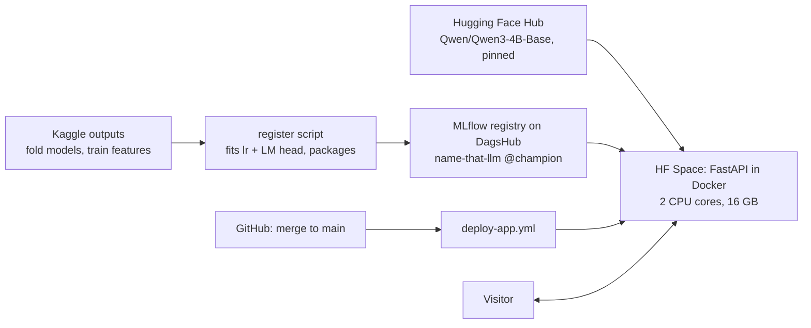

# P4 design: the live demo app (App v1 and CD)

Date: 2026-10-26. Written with the user during P4's brainstorming. It builds on the
[project design](2026-10-23-name-that-llm-design.md) (§7 "The app", §6.11 "CI/CD", §8 "The
pro stack") and changes it where marked. Claude's own calls are listed in §11 for the user
to check.

## 1. Intent

Anyone who has a text written by an AI chatbot pastes it into a web page and sees which of
our 18 models most likely wrote it: a ranking with percentages. It's the project's public
face (goal G3), and the first time a model leaves Kaggle to serve real people, so P4 also
builds the production path behind it: packaging, a model registry, Docker, hosting and
continuous deployment (CD).

**What a visitor should take away:** an honest answer, not a verdict. Our best model names
the exact model about 4 times in 10, and models from the same company write alike, so the
page shows its uncertainty and its limits plainly.

## 2. Goals, non-goals, anti-goals

**Goals**
- A public Hugging Face Space where a pasted passage returns the 18 models ranked with
  percentages, in about 5 seconds.
- It serves our **real best model**, the leaderboard champion (public LB 0.410), not a
  lighter cousin. That was the user's explicit choice.
- Every merge to `main` that touches the app redeploys it automatically, then checks it.
- A model card that says what the app is and isn't.

**Non-goals for P4** (most belong to P6, the MLOps loop)
- The "Was this right?" feedback button, the `/metrics` endpoint, Prometheus and Grafana,
  Evidently, the online A/B test.
- Shadow mode: a heavier model answering in the background, logged but not shown (the
  user's idea, logged as IDEAS I-024 for P6).
- Telling human text from AI text, or flagging texts from models outside the 18. It's out
  of the competition's scope (the user's own conclusion); flagging unusual texts is logged
  as IDEAS I-025 for P6.
- A GPU, paid hosting, user accounts, other languages.

**Anti-goals** (failures even if everything technically works)
- Showing any passage from the competition data. Its data-security clause forbids
  redistributing it, so the page has no sample passages (§11, call 3).
- Storing or logging a visitor's text.
- Claiming to detect AI, or to know models beyond the 18.
- Serving a different model than the page and `/version` claim, or falling back to a weaker
  model silently.

## 3. The page (decided)

The user chose **layout B** from three mockups, then added the warning. One page:

1. **Top:** the title "Which LLM wrote this?", one line saying what the app does, a box to
   paste a passage, and an **Identify** button.
2. **While it works:** a progress message such as "Reading the passage… about 5 seconds".
3. **The answer:**
   - **The best guess in big letters,** with its company and percentage (for example
     "gpt-5.6-luna, by OpenAI, 38%").
   - **A "How sure?" line** in plain words (for example "Unsure: the best guess has only
     38%"). It describes the model's own confidence, never where the text came from.
   - **The top 5 as bars,** each with its company, then "Show all 18" for the rest.
4. **A warning box, always visible**, titled "Before you trust this":
   - It is not an AI detector. It only knows these 18 models and always picks one of them,
     even for text written by a human or by another AI.
   - It learned from 2,699 passages from a Kaggle competition (about 150 per model), so
     other topics or writing styles can fool it.
   - On new passages, it names the exact model right about 4 times in 10.
   - A link to the model card.

The companies come from `labels.LAB_OF` (Anthropic, Google, Z.ai, OpenAI, Moonshot, Qwen).
Visitors copy text from their chatbot and paste it with Ctrl+V. The approved mockup:
[2026-10-26-p4-app-mockup.html](2026-10-26-p4-app-mockup.html) (open it in a browser).

## 4. The model (decided, and measured)

**The full champion,** exactly as submitted (`configs/ensemble.yaml`): a weighted mean of
three models' probabilities, with weights 0.70 / 0.15 / 0.15.
1. **`lr`**: the word + character TF-IDF logistic regression, fit on all 2,699 passages.
2. **The LM head**: Qwen 3 4B base, mean-pooled hidden states of layers 6 to 9 (at most 512
   tokens), averaged, then a scaled logistic regression (C = 0.1) fit on all 2,699
   passages' features.
3. **The encoder**: the 5 seed-42 ModernBERT-base fold models from notebook 09, averaged
   (at most 512 tokens).

On a non-finite output, it behaves like the submission: LM features fall back to the
training mean, and an encoder row to the uniform distribution.

**Measured during brainstorming**, with throwaway spikes: a private Kaggle notebook
[`ryqn00/name-that-llm-cpu-timing`](https://www.kaggle.com/code/ryqn00/name-that-llm-cpu-timing)
on server CPUs limited to 2 threads, plus local runs.

| Fact | Value |
|---|---|
| Accuracy on fresh folds (mean of seeds 42, 43, 44) | `lr` 0.325 · `lr` + encoder 0.387 · `lm_blend` 0.402 · **champion 0.423** |
| Public leaderboard | `lr` 0.320 · `lm_blend` 0.389 · **champion 0.410** |
| Qwen cut to its first **10** blocks vs the full model, on layers 6–9 | **identical** (difference 0). A 9-block cut is wrong: the model normalizes its last output |
| Qwen features on CPU (float32) vs the GPU features (float16) the LM head learned from | 0.1% median difference; the same top label on 20 of 20 passages |
| Time per passage on 2 CPU threads | Qwen 2.70 s · encoder 0.34 s per fold model · `lr` + LM head 0.014 s · **champion ≈ 4.4 s** (≈ 3.1 s with 1 fold model) |
| Memory (float32) | Qwen's 10 blocks 5.2 GB (15 GB for the full model) · encoder 0.56 GB per fold model · **champion ≈ 8 GB** |
| Fitting at startup | `lr` 52 s, LM head 22 s, so they ship pre-fitted |
| Passage length in the training data | 36 to 274 words, median 101 |
| 8-bit quantization of the encoder | 2× faster, but changed the top answer on every test passage: not used |

## 5. How it's built (decided)

- **Inference lives in the package.** One predictor in `src/name_that_llm/` does the whole
  pipeline: flattening (§6), `normalize_text`, the three models, then the blend. It reuses
  the existing functions (`pooled_hidden_states`, `select_layers`, `predict_proba_folds`,
  `blend`, the `LABELS` order), so the app computes exactly what the submission computes.
- **Packaging and registry** (design §8, kept): an MLflow `pyfunc` model registered as
  `name-that-llm` with the alias `champion`, on DagsHub's free MLflow server.
  - Its artifacts: the fitted `lr` (without the `stop_words_` attribute, which is only for
    inspection), the fitted LM head, the 5 encoder fold models, the blend weights, the
    "How sure?" bands (§6), and the Qwen repo id with a pinned revision.
  - Qwen's weights are not in the registry. They're public (Apache 2.0) and come from
    `Qwen/Qwen3-4B-Base` on the Hugging Face Hub, loaded as 10 blocks.
- **Registration:** a script that runs anywhere. P4 runs it once, by hand; P6 automates it.
  It fits `lr` and the LM head on all of train, the LM head on the GPU features saved by
  the `lm-features` notebook, then logs the model and sets `@champion`.
  - Its inputs: the competition data in `data/raw`, plus the outputs of two Kaggle
    notebooks, downloaded with the Kaggle CLI. From `lm-features`: `features-4b-base.npy`
    and `train_ids.npy`, checked against the row order. From `encoder-final`: the 5 fold
    folders and the out-of-fold files used for the "How sure?" bands.
  - Before registering, it checks that Qwen from the Hub gives the same features as the
    Kaggle copy the LM head learned from: at most about 1% difference, and the same top
    labels on a sample.
  - Kaggle notebooks aren't the place for it: pushed notebooks can't read Kaggle Secrets
    (see W&B in P5).
- **The app** (`app/`): FastAPI plus Uvicorn in one Docker container, on a free Hugging Face
  Space (Docker SDK, 2 vCPUs, 16 GB). At startup it loads `models:/name-that-llm@champion`
  with `mlflow.pyfunc`, then Qwen.
  - `GET /`: the page (§3).
  - `POST /predict`: the text in; all 18 models sorted, with company and probability, the
    "How sure?" band, the model version and the time taken out.
  - `GET /health`: 503 while the models load, 200 when ready.
  - `GET /version`: the package version, the registry version, the Qwen revision and the
    git commit.
- **One prediction at a time:** 2 cores and about 8 GB of models. Requests wait in a short
  line; beyond it, a polite 503 "busy, try again".
- **CI** (`ci.yml`): adds the API tests and a Docker build.
- **CD** (`deploy-app.yml`, design §6.11): on a push to `main` that touches `app/` or `src/`:
  1. push to the Space;
  2. wait until `/health` returns 200 (allowing for model loading);
  3. send one `/predict` with a fixed text written for the purpose, never from the
     competition, and check that it returns 18 labels whose probabilities sum to 1.

## 6. Input handling (decided)

- **Flattening.** The host flattened every training passage into a single paragraph with no
  markdown. None of the 2,699 has a line break, a heading, bold, a backtick or a bullet.
  Chatbot text pasted by visitors has all of these, so the predictor flattens it the same
  way before anything else:
  - remove the markdown syntax: headings, emphasis markers, list bullets, code fences,
    quotes and tables;
  - keep the text of links;
  - join everything into one paragraph with single spaces;
  - then `normalize_text`.

  It must leave training-style text unchanged. Checked locally on the real data, the
  flattening must return all 2,699 passages exactly as they are (15 contain a `*` and 11
  contain a pattern like "1. ", which must survive). Unit tests use fake text, as always.
- **Validation** (design §7, kept): 20 to 1,000 words, a cap on the request size, and a
  per-visitor rate limit.
  - The page says it works best on 50 to 300 words: training passages are 36 to 274 words,
    and the two neural models read only about the first 350 to 400 words.
- **"How sure?" bands:** they map the top probability to plain words. Their edges and
  wording are backed by data: out-of-fold predictions show how often the top guess is right
  in each band. The bands are stored with the registered model, so they change only when
  the model does.
- **Privacy:** the text is never stored or logged. Logs keep only its length, the time
  taken and the prediction. The page says so.

## 7. Constraints

- Free tiers only: Hugging Face Spaces (CPU basic) and DagsHub. No GPU, no billing risk
  (design §8).
- The Space has 2 vCPUs and 16 GB of memory, and sleeps after about 2 days without visitors.
  Waking up downloads and loads the models, which takes a few minutes.
- Secrets live only in GitHub Secrets and Space secrets (`HF_TOKEN`, the DagsHub token).
- Competition rules: no training passage ever appears in the app, the repo or the logs.
- Project conventions: TDD, fake data in tests, heavily commented code (the "why"), the ship
  procedure (a branch, a PR, a CI-gated merge), MIT license, and a journal entry at the
  end (`docs/journal/p4-app.md`).

## 8. What the user needs to do

Claude will guide each step.
1. **Hugging Face:** create an account and a write token. The token becomes the GitHub secret
   `HF_TOKEN`, which CD uses to push to the Space. The Space will be
   `<hf-username>/name-that-llm`.
2. **DagsHub:** create an account and connect the GitHub repo (`Ryqn0/name-that-llm`). Its
   token goes into the Space's secrets (to load the model) and into the local environment
   (to register it).
3. **Approve:** the first deploy and the first registration, like Kaggle pushes.

## 9. Done when

1. The public Space works: a pasted passage gets its ranking in about 5 seconds (no more than
   10) on the Space's CPU.
2. Its predictions match the offline champion on a fixed set of passages, to within float
   noise, and `/version` names the registry version that produced them.
3. A merge to `main` that touches the app redeploys it, and the deploy's `/health` and
   `/predict` checks pass.
4. The model card and the warning box are live.
5. CI runs the API tests and the Docker build on every PR.
6. Context, DIARY and the P4 journal are updated, and an ADR records the call to serve the
   full champion on CPU with a 10-block Qwen.

## 10. Left to the builder

- The libraries for the rate limit and the markdown stripping, and the file layout inside
  `app/`.
- The queue length, the rate-limit numbers and the request size cap.
- The edges and wording of the "How sure?" bands, from the out-of-fold data.
- Speeding up startup, if waking takes more than about 5 minutes: baking the models into the
  image, or publishing a 10-block copy of Qwen.
- **The fallback rule:** if the champion takes more than 10 seconds per passage on the
  Space's CPU, serve it with 1 encoder fold model (≈ 3.1 s in the spike). The page and
  `/version` must then say so.
- How CD fills the Space's own git repo: it needs the Dockerfile, `app/`, the package source
  and the lock file.
- The page's styling. The structure follows §3 and the mockup.
- **One limit:** if DagsHub's free tier can't hold or serve the ~1.5 GB of fold models,
  stop and ask the user before changing the registry. That would change the design.

## 11. Calls Claude made (for the user to check)

1. **Serve the exact submission (5 encoder fold models), at about 4.4 s.** One fold model
   would save about 1.3 s, but it's not quite the model that scored 0.410.
2. **One answer.** There's no quick first answer from a lighter model: at 4 to 5 seconds, it
   would add complexity for little gain.
3. **No sample passages in v1.** Competition passages can't be published, and samples would
   need texts we write ourselves.
4. **The feedback button, metrics, the online A/B and shadow mode wait for P6.**
5. **Keep the MLflow registry on DagsHub** from the project design. Its repo stays private.
   The files hold no passages, but private costs nothing.
6. **Registration runs once by hand in P4,** and gets automated in P6.
7. **Qwen comes from the official Hub repo at a pinned revision,** not from our registry.
8. **Flatten pasted text** so it matches the training data's format.
9. **Back the "How sure?" wording with data,** not with fixed thresholds.
10. **Keep the 20 to 1,000 word limit,** with a note that the app works best on 50 to 300
    words.
